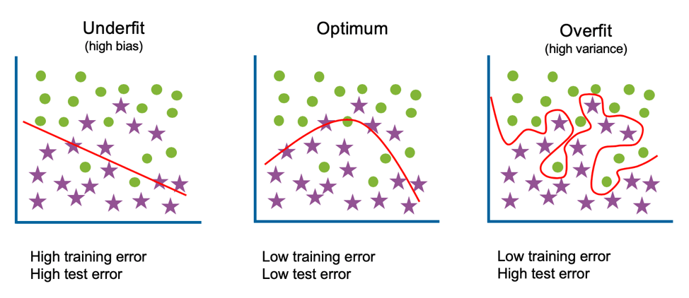
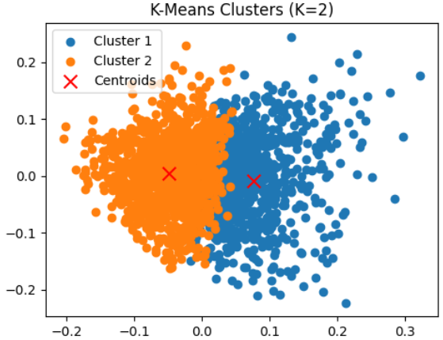
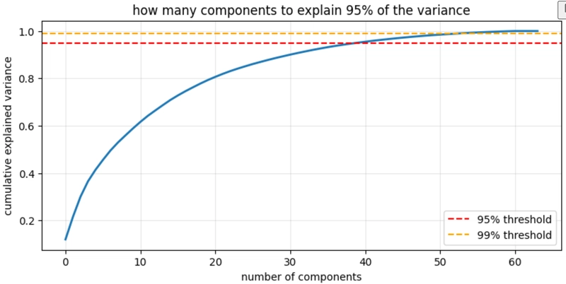
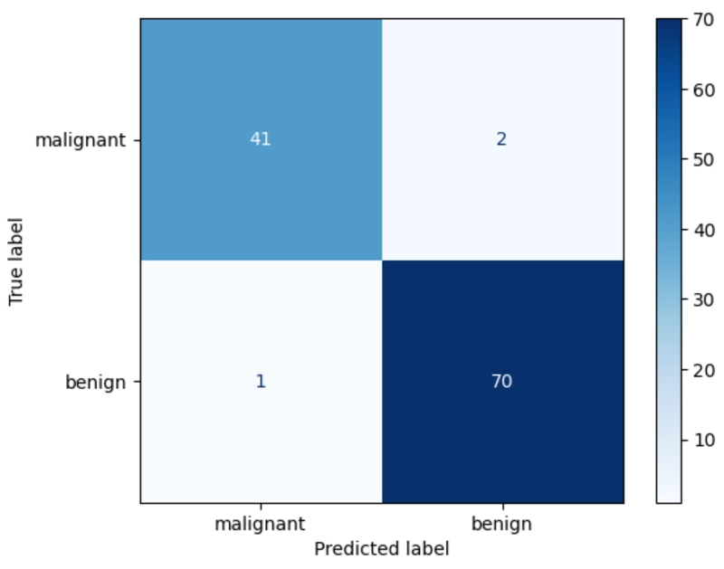
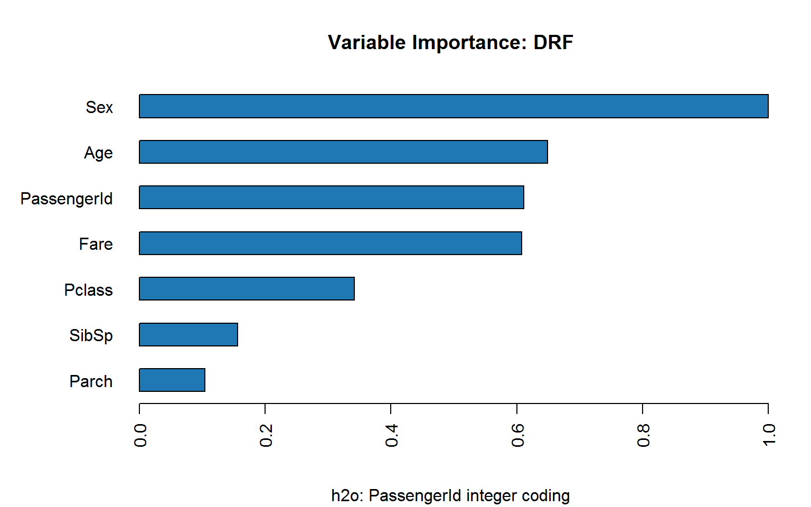
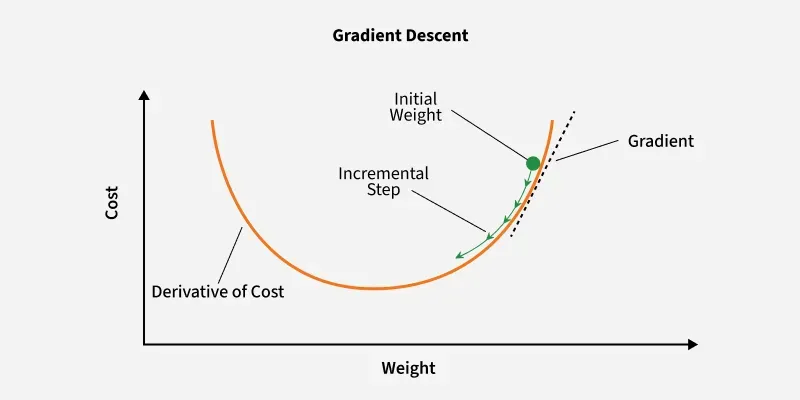
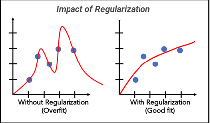
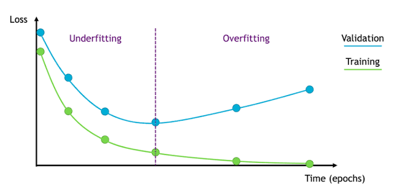
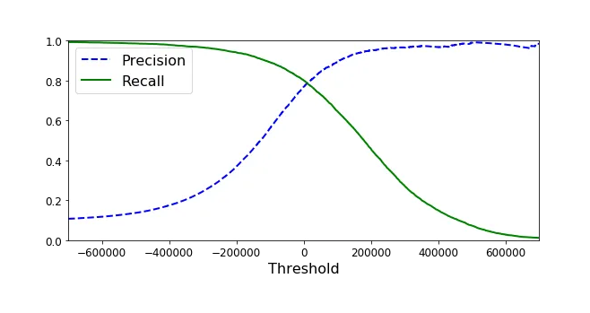

### 1. What is the role of a data scientist in a modern organization?
A data scientist bridges the gap between raw data and actionable business insights. They design experiments, build predictive models and communicate findings to non technical stakeholders to drive data informed decisions.

### 2. Explain the bias variance tradeoff with an example.
Bias measures how far model predictions are from the true values(underfitting risk), while variance measures sensitivity to fluctuations in training data(overfitting risk). A polynomial degree-1 model on curved data has high bias; a degree-20 model on noisy data has high variance. The sweet spot minimises total error.

### 3. What is cross validation and why should you use K-fold instead of a single train-test-split?
Cross validation repeatedly splits data into training and validation folds to estimate generalization error. K-fold CV uses every sample for both training and validation across k rounds giving a lower variance performamce estimate and making better use of limited data than a single split.

### 4. Walk through the key steps of data preprocessing before modelling.
The pipeline typically covers: 
1. Data collection and auditing
2. Handling missing values 
3. Outlier detection
4. Feature encoding for categoricals
5. Scaling/normalization
6. Feature Engineering 
7. Train test splitting.
Each step reduces noise and ensures the model receives clean comparable inputs.

### 5. Compare L1 (Lasso) and L2(Ridge) regularization. When would you choose each.
L1 adds the sum of absolute coefficeint values as a penalty, shrinking irrelevant coefficients to exactly zero and producing sparce models. - ideal for feature selection.

L2 adds the sum of squared coefficients distributing shrinkage across all features without zeroing them. - preffered when all features may be relevant  

### 6. What strategies exist for handling missing data and what are the trade-offs?
1. Litwise deletion - simple but loses information
2. Mean/Mode/Median imputation - fast but ignores uncertainity
3. K-Nearest Neighbour Imputation - captures local patterns
4. Multiple imputation - gold standard. preserves variability
5. Model based imputation using algorithms such as random forest
The best choice depends the missing data mechanism (MCAR, MAR or MNAR) 

### 7. How does K-Means clustering work and what are its main limitations?
K-Means iteratively assigns each points to its nearest centoids then recomputes the centroids until convergence minimising within cluster sum of squares.

Limitations:
- Requires the number of clusters K to be specified in advance
- Assumes spherical clusters of similar size
- Is sensitive to initialization and outliers 
- Struggles with non convex shapes

### 8. What metrics would you use to evaluate a classification model, and when does accuracy mislead you?
Key metrics: Precision, Recall, F1-Score ROC-AUC and Log loss.
Accuracy misleads when classes are imbalanced - A model predicting the majority class for every observation can achieve 99% accuracy on a 99:1 dataset while being useless. In such cases F1-score is more informative.

### 9. Interpret a confusion matrix and explain how precision and recall are derivved from it
A confision matrix cross tabulates actual vs predicted classes. 
- True positives (TP) are correct positive predictions.
- False Positives (FP) are incorrect positive predictions.
- False Negatives (FN) are missed positives
- True Negatives (TN) are correct negative predictions
- Precision = TP/(TP + FP)
- Recall = TP/(TP + FN)

Precision answers "how many flagged cases are real" 
Recall answers "how many real cases did we catch"

### 10. Why is feature scaling important and which algorithms are most sensitive to it?
Feature scalling ensures all features contribute equally to distance and gradient computations.
Algorithms sensitive to scale include: 
- K-Nearest Neighbours (uses euclidean distance)
- SVM (Maximizes margin in feature space)
- Neural Networks (gradient descent converges faster)
- PCA (variance based) 

Tree based models such as Random Forest and XGBoost are scale invariant.

### 11. How does Random Forest differ from a single Decision Tree, and what makes it more robust?
A single Decision Tree is prone to overfitting because it memorizes training data. Random Forest builds many trees on bootstrap samples of the data and at each split considers only a random subset of features(bagging + feature randomness). They ensemble averages prediction dramatically reducing varaiance without increasing bias.

### 12. Explain the difference between bagging and boosting.
Bagging (e.g Random forest) trains models independently in parallel on random data subsets and averages result primarily reducing variance. 

Boosting (e.g XGBoost, AdaBoost) trains models sequentially with each learner focusing on the errors of its predecessor primarily reducing bias. 

Bagging is less prone to overfitting: Boosting often achieves higher accuracy but needs careful tuning.

### 13. What is gradient descent and how do batch, mini-batch and stochastic variants differ?
Gradient descent iteratively updates models parameters by moving in the direction of steepest loss decrease. 
Batch GD uses the full dataset per update - stable but slow for large data.

Stochastic GD updates after each sample - fast but noisy.

Mini-batch GD(the standard in deep learning) uses small random batches balancing speed and stability.
 

### 14. What is multicolinearity, how do ypou detect it, and what can you do about it?
Multicollinearity occurs when predictor variables are highly correleated, inflating coefficient standard errors and making interpretations unreliable.

Detection: Variance Inflation Factor (VIF > 10 signals a problem), Correlation heatmaps, condition number.

Remedies: Remove one correlated feature, apply PCA to collapse features, using ridge regression which handles collinearity gracefully.

### 15. Explain the purpose and intuition behind Support Vector Machines (SVM)
SVM finds the hyperplane that maximizes the margin between classes. Data points lying closest to the boundary are called support vectors - they define the hyperplane. For non linerly separable data, kernel fuctions (RBF, Polynomial) impicit map inputs to a higher dimensional space where a linear boundary exists. SVM works well in high dimensional spaces and with small datasets.

### 16. How does the Naive Bayes classifier work and why is the 'naive' assumption problematic?
Naive Bayes applies Bayes' theorem with the assumptions that the features are conditionally independent given the class. This strong assumption rarely holds in practice - words in co-occurences in text, for instance are correlated. Despite this the classifier is computationally cheap works well on text classification and performs suprisingly well even when independence is violated.

### 17. How do you handle outliers in a dataset?
First, investigate whether outliers reflect extreme values or data errors. For genuine outliers: use robust models (e.g tree based) or robust loss functions (Huber)

For errors: remove or cap via winsorisation. Log transformation and Square root transformation compress extreme values. Always separate treatment for training and test data to avoid data leakage.

### 18. State the Cental Limit Theorem and explain its practical significance in Data Science.
The Central Limit Theorem states that the sampling distribution of the sample mean approaches a normal distribution as sample size grows regardless of the population's shape (given finite variance). Practically this justifies using Z-tests and tests for inference on large samples, underpins confidence intervals and explains why many natural measurements are approximately normal.

### 19. What is Principal Component Analysis and when should you use it?
PCA projects data into orthogonal axes (principal componets) that capture maximum variance enabling dimensionality reduction. Use PCA when features are highly correlated, when visualizing data in high dimensional data in 2D/3D or when computational cost is a concern.

Important caveat: PCA loses interpretability - principal components are linear combinations of original features.

### 20. Explain Ensemble learning and give examples of when it outperforms individual models.
Enseble learning combines predictions from multiple base learners to improve accuracy and robustness.
It Excels when: 
1. Individual models have complimentary strenghts.
2. Data is noisy (Variance reduction via bagging)
3. The problem is complex (bias reduction via Boosting)

In Kaggle competitions, Gradient boosted ensembles (XGBoost LightGBM) and stacking consistenlty dominate.

### 21. What is XGBoost and what makes it more efficient than traditional Gradient Boosting?
XGBoost (Extreme Gradient Boosting) extends gradient boosting with: second-order Taylor expansion of the loss, built in L1,L2 regularization, column and row sub-sampling, hardware-optimized parallel tree construction and native handling of missing values. These improvements make it faster, more regularized and consistently high-performing on tabular data.

### 22. How do you select the optimal number of clusters K in K-Means?
The common aproaches:
1. Elbow method - Plot inertia vs K and look for the 'elbow' where gains plateau.
2. Silhouette score - measure how similar each point is to its own cluster versus others (higher is better)
3. Gap ststistic - compares within cluster dispersion to that of a reference null distributiuon. Domain knowledge should always validate the choosen K.

### 23. Explain the purpose and mechanics of LSTM networks.
Long Short Memory networks are a recurrent architecture that address the vanishing gradient problem through gating mechanisms - the forget gate discards irrelevant history. The input gate selects new information and the output gate controls what is exposed to the next layer. This allows LSTMs to learn long range dependecies in sequential data such as text, audio and time series.

### 24. What is the difference between RMSE and MAE and when would you prefer each?
Root Mean Squared Error (RMSE) squares errors before averaging, penalising large errors heavily. Mean Absolute Error (MAE) averages absolute errors, treating all deviations equally. Prefer RMSE when large errors are especially undesirable (e.g. financial forecasting). Prefer MAE when outliers exist and you want a more robust metric. RMSE is differentiable everywhere making it easier to optimize.

### 25. How do you handle imbalanced datasets in a classification problem?
Strategies:
1. Resampling - oversample the minority class(SMOTE generates synthentic samples) or undersample the majority.
2. Class weight adjustment - penalize misclassifying the minority more heavily.
3. Threshold tuning - choose a threshold that maximises F1 or Recall.
4. Algorith selection - use models robust to imbalance such as XGBoost with scale_pos_weight. Always evaluate with F1, PR-AUC, or Mathews Correlation Coefficient rather than accuracy.

### 26. What is the purpose of a recommendation system and what are the main approaches?
Recommendation systems predict user preferences to surface relevant items.
Main approaches:
1. Collaborative Filtering - Identifies users with similar behaviour (memory based) or learns latent factors via matrix factorisation (model based).
2. Content Based Filtering - matches items to a user's historical preferences based on item attributes.
3. Hybrid systems combine both mitigating cold start problems.

### 27. Explain the vanishing gradient problem in deep networks and how modern architectures address it?
During backpropagation gradients are multiplied through many layers. With sigmoid/tanh activations, gradients shrink exponentially in early layers preventing learning.
Solutions:
1. ReLU activations - gradient is either 0 or 1 limiting shrinkage.
2. Batch Normalization - re centers activations per mini-batch.
3. Residual connections (ResNet) - skip connections allow gradients to flow directly.
4. Careful weight initialization (He, Xavier).

### 28. What is overfitting and what is your toolkit controlling it?
Overfitting occurs when a model memorizes training data and fails to generalise.
Countermeasures:
1. More training data.
2. Cross validation to detect overfitting early.
3. Regularization (L1,L2, dropouts in Neural Networks)
4. Early stopping based on validation loss.
5. Reducing  model complexity (fewer layers, lower polynomial degree)
6. Data Augmentation.

### 29. Describe the concept of backpropagation in neural networks.
Backpropagation computes the gradient of the loss with respect to each weight using the chain rules of calculus, flowing gradients backward from the output layer to the input layer. An optimiser (SGD, Adam) then updates each weight by a step propotional to its gradient. 
- Fast foward pass computes predictions
- backward pass computes gradients
- Optimiser applies updates - this cycle repeats for many batches

### 30. What is the purpose of t-SNE, and how does it differ from PCA for visualization?
t-Distributed Stochastic Neighbour Embedding(t-SNE) is a nonlinear technique optimised for 2D/3D visualizations of high dimensional data. it preserves local neighbourhood structure - nearby points in high dimensions remain nearby in the projection. Unlike PCA (Which maximizes global variance), t-SNE reveals clusters and manifold structure but is non deterministic, computationally expensive and distances between clusters are not interpretable.

### 31. What is feature importance in tree based models and how is it measured?
Feature importance quantifies each feature's contribution to models predictions. In tree models,it is typically measured as the total reduction in the chosen impurity measure (Gini or entropy) from the splits on that feature, weighted by the number of samples. Permutation importance (randomly shuffling a feature and measuring perfomance drop) is a model-agnostic alternative that is more reliable for correlated features.

### 32. How do you diagnose and address  multicollinearity in a regression model?
Diagnosis:
Compute pairwise correlations and Variance Inflation Factors (VIF) A VIF above 10 (some use 5) indicates a problematic level of collinearity.
Solutions:
- Drop one of the correlated predictors, combine them into a single feature, apply PCA to create orthogonal components or use Ridge regression which handles collinearity by shrinking coefficients propotionally.

### 33. What is the Gini index and how is it used to build a Decision Tree?
The Gini index measures node impurity: Gini = Gini = 1 − Σ (pᵢ)²
A perfectly pure node (all one class) has Gini = 0. At each split, the algorithm evaluates all possible feature threshold combinations and selects the one that maximizes the weighted reduction in Gini across child nodes. Entropy (information gain) is an alternative impurity criterion - both yield similar trees in practice.

### 34. Explain the concept of R-Squared and its limitations as a regression metric.
R² measures the propotion of variance in the depedent variable explained the model: 
- R² = 1 - SS_res/SS_tot. A value of 0.85 means 85% of variance is explained.

Limitations:
- R² always increases as more predictors are added ( use adjusted R² instead ) it does not indicate whether coefficients are statistically significant and a high R² does not guarantee a good prediction on new data.

### 35. What is the Apriori algorithm and where is it applied?
Apriori discovers frequent item sets in transactional databases using the anti monotonicity property:
If an itemsent is infrequent all its supersets are too, enabling efficient pruning.

From frequent itemsets it generates association rules with metric support (Frequency) confidence (conditional probability) and lift (improvement over baseline)

Classic application - market basket analysis (customers who buy bread also buy butter).
### 36. How do you handle highly skewed data distributions before modelling?
Options:
1. Log transformation - effective for right skewed, positive data.
2. Square root or cube root transformation - milder compression.
3. Box-Cox transformation - parameterized family that includes log as a special case.
4. Yeo-Johnson - extends B0x-Cox to 0 and negative values.
5. Quantile transformation - maps to uniform or normal distribution.

Always apply transformations only to training data and apply same parameters to test data.

### 37. What is Mean Average Precision(MAP) and in what context is it used?
Map is a metric for ranked retrieval systems (search engines, recommenders). For each query, Average Precision (AP) sums precision at each rank where a relevant document is retrieved. MAP averages AP across all queries. It rewards systems that rank relevant results high and penalises systems that place relevant results at the bottom of the list.

### 38. Explain the Euclidean and Cosine distance metrics - when does each apply?
- Euclidean distance measures the straight line distance between two points in a feature space - appropriate when the magnitude of feature values matters (e.g. K-Means on continous measurements).
- Cosine similarity measures the angle between two vectors, ignoring magnitude - appropriate for text data where document length should not influence similarity (e.g. TF-IDF vectors in NLP).

### 39. How do you handle non-liniearity separable data in classification?
Approaches:
1. Kernel SVM - maps data to a higher dimensional space where it becomes linearly separable using RBF, polynormial or sigmoid kernels.
2. Feature engineering - manually creates polynomial or interaction features.
3. Non-Linear models - Decision Trees, Random Forest and neural networks learn non linear boundaries directly.
4. t-SNE or UMAP for visualizing non linear structure.

### 40. What is Chi-square test and how is it used in feature selection?
The Chi-square test asseses whether two categorical values are statistically independent by comparing observed frequencies in a contingency table to expected frequencies under indepedence. In feature selection for classification a high chi-square statistic (low p-value) between a feature and the target label indicates the feature carries useful signal and should be retained.

### 41. What is ANOVA and when would data scientists apply it?
Analysis of Variance (ANOVA) tests whether the meansd of three or more independent groups are significantly different.

A data scientist uses is to:
1. Compare model performance across multiple algorithms.
2. Evaluate whether a feature's mean differs meaningfully across target classes (useful for feature selection)
3. Validate A/B test results involving more than two variants.

The F-statistic compares between group to within group variance

### 42. How do you handle time series data in a machine learning pipeline?
Key steps:
1. Ensure chronological train-test splitting - never use future data to predict the past.
2. Engineer time based features: lag values, rolling staistics, seasonability indicators.
3. Choose Appropriate models - ARIMA for stationary series Prophet for trend + seasonability, LSTM for complex long range patterns.
4. Evaluate with time-series cross validation (walk foward validation) rather than standard K-fold.

### 43. What is the K-Nearest Neighbors (KNN) algorithm and what are its computational challenges?
Knn classifies a new point by majority vote of its K nearest neighbours (classification) or averages their values (regression) using a distance metric such as Euclidean or Cosine.
Challenges:
1. 0 (n.d) prediction time - scales poorly with dataset size n and dimensionality d.
2. Curse of dimensionality - distances become less meaningful in high dimensions.
3. Sensitive to irrelevant features and scale - requires feature selection and normalization.

### 44. Explain Log Loss and why it is preferred over accuracy for probabilistic classifiers.
LogLoss (cross-entropy) measures the negative log-probability assigned to the true label:-(y.log(p) + (1-y).log(1-p)). A model says '99% confident - wrong' is penalized much more than one that says '51% confident - wrong'. This rewards calibrated, well calibrated probabilities rather than just binary correctness, making it more informative for probabilistic classifiers like logistic regression and neural networks.

### 45. What techniques address high dimensional data (the 'curse of dimensionality')?
The curse of dimensionality causes data to become sparse and distance to lose meaning in high dimensions. 

Remedies:
1. Feature Selection - remove irrelevant or redundant features (Lasso, mutual information, RFE).
2. Dimensionality reduction - PCA(linear), t-SNE/UMAP (non-linear).
3. Regularisation - penalises unnecesary complexity.
4. Domain knowledge - engineer meaningful low-dimensional features.

### 46. What is the F1 score and when should you optimize it over precision or recall alone?
F1 = 2.(Precision.Recall)/(Precision + Recall) the harmonic mean that balances both. Optimise for F1 when false positives and false negatives are both costly - e.g. medical screening (high recall desired) vs spam detection (high precisiuon desired). If costs are asymmetric, adjust: Fβ = (1 + β²).(P.R) / (β².P+R) Where β > 1

### 47. Explain hyperparameter tuning - what methods exist and how do you avoid overfitting to the validation set?
Hyperparameters controls model structure (learning rate, tree depth, regularization strenght).

Tuning methods:
1. Grid Search - exhaustive.
2. Random Search - more efficient, often near optimal.
3. Bayesian Optimisation(Optuna, hyperopt) - builds a probabilistic model of the objective.
4. Early Stopping on a held out set. Avoid overfitting to validation by using nested cross-validation or a final held-out test set never used during tuning.

### 48. What is data leakage and why is it one of the most dangerous pitfalls in machine learning?
Data leakage occurs when information from outside the training dataset is used to build the model - e.g. scaling using test set statistics, including a targeted correlated feature computed after the event or shuffling before splitting time series data. Leaked models appear to perform exceptionally well but fail catastrophically in production. Prevention: always fit preprocessing transformers on training data only and apply to test data.

### 49. What the purpose of the logistic function in logistic regression?
The logistic (sigmoid) function σ(z) = 1 / (1 + e^{-z}) maps any real-valued linear combination of features to the interval (0,1) making it interpretable as a class probability.  The decision boundary is set where σ(z) = 0.5 (i.e. z = 0). The model is trained by minimising binary cross-entropy (logloss) which is convex and enables gradient-based optimization.

### 50. How do you approach feature engineering and what impact does it typically have on model perfomance?
Feature engineering transforms raw data into informative represenations. 

Key techniques: 
1. Interaction terms and polynormial features.
2. Aggregations (mean, std of related records).
3. Date/time decomposition (hour, day-of-week, is-weekend).
4. Target encoding for high cardinality categoricals.
5. Domain-specific ratios (e.g. debt-to-income)

Good feature engineering often contributes more to performance than algorithm selection especially on tabular data.

